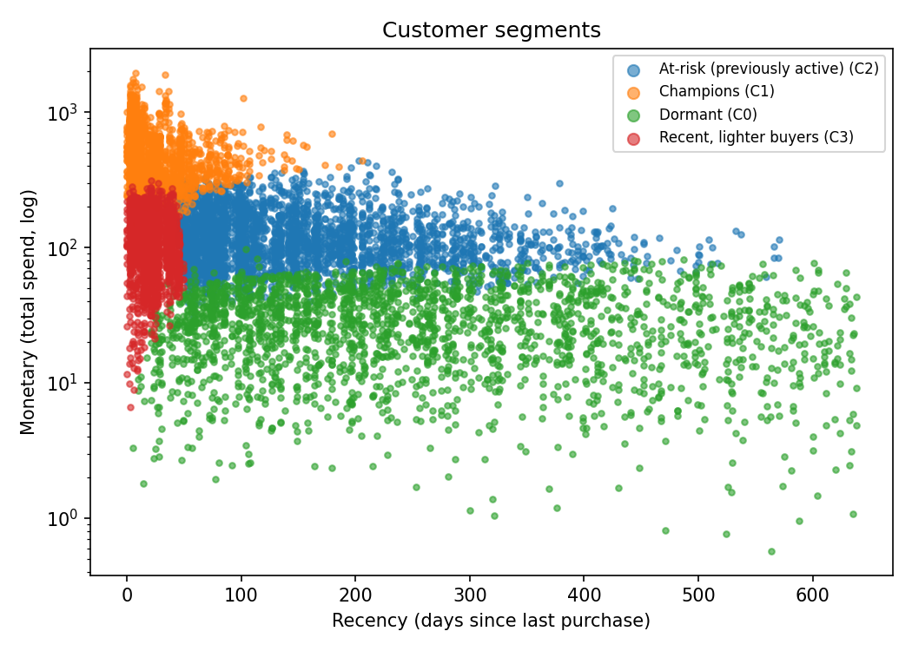
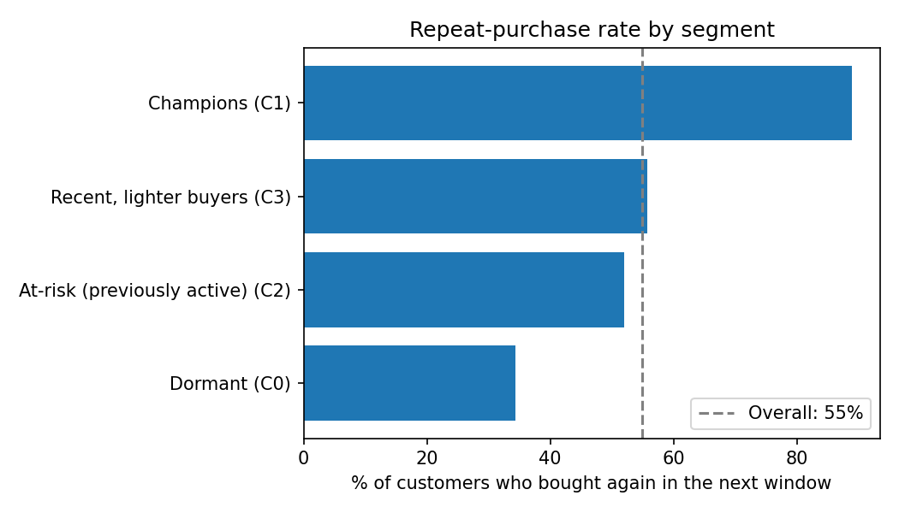

# Maven Market: Customer Segmentation & Repeat-Purchase Prediction

A small end-to-end machine learning project on retail transaction data.
It answers two business questions:

1. **Who are our customers?** Segment them by Recency / Frequency / Monetary value (RFM) with K-Means.
2. **Who will buy again in the next 90 days?** Predict it, so marketing can protect valuable customers and win back at-risk ones.

This extends my earlier [Maven Market Sales Analysis](https://github.com/nganhduong123/SalesDA) from descriptive analysis to modeling.

## Approach

| Step | What I did |
|---|---|
| 1. Prepare data | Merged transactions with product prices, computed revenue = quantity x retail price, cleaned missing values |
| 2. Avoid data leakage | Picked a **cutoff date** (last transaction date - 90 days). All features come from data on/before the cutoff. The label is "bought at least once in the 90 days after the cutoff" |
| 3. Feature engineering | Recency, frequency (visit days), monetary value, average spend per visit, number of products/stores, tenure, visits in the last 90 days |
| 4. Segmentation | K-Means on log-scaled, standardized R/F/M; k chosen from 3-6 using silhouette score and business interpretability |
| 5. Prediction | Naive baseline (recency only) vs Logistic Regression vs Random Forest, evaluated on 25% held-out customers |
| 6. Business view | Repeat rate per segment, top-decile lift, permutation feature importance, scored customer list |

## How to run

```bash
pip install -r requirements.txt

# 1. The Maven Market CSV files (free dataset from Maven Analytics) are included in ./data
python customer_segmentation_and_repeat_purchase.py --data-dir ./data

# Optional
#   --horizon 60   look ahead 60 days instead of 90
#   --k 5          force the number of segments
#   --demo         run on synthetic data just to test the pipeline
```

If your CSV column names differ from the defaults, edit the `COL_*` constants at the top of the script.

Outputs are saved to `outputs/`: `segment_summary.csv`, `model_metrics.csv`, `customer_scores.csv` and four charts.

## Results

Run on the Maven Market data (transactions 1997-1998), history up to 1998-10-01, 90-day prediction window.

- **8,529 customers** with purchase history; **55.0%** of them bought again in the next 90 days.
- **4 segments** (K-Means on log-scaled RFM, k chosen by silhouette score):

| Segment | Customers | Avg recency (days) | Avg frequency (visit days) | Avg spend | Bought again in 90 days |
|---|---|---|---|---|---|
| Champions | 1,613 (19%) | 27 | 15.3 | $493 | 89% |
| Recent, lighter buyers | 1,507 (18%) | 21 | 4.2 | $119 | 56% |
| At-risk (previously active) | 3,117 (37%) | 149 | 4.4 | $127 | 52% |
| Dormant | 2,292 (27%) | 252 | 1.4 | $30 | 34% |

- Champions are 19% of customers but account for **55% of spend** before the cutoff; Dormant customers are 27% of customers but only 5% of spend.
- **Repeat-purchase model** (ROC-AUC on 25% held-out customers): recency-only baseline **0.654**, Logistic Regression **0.719**, Random Forest **0.720**.
- Random Forest: precision 0.73 / recall 0.58 at threshold 0.5. The top 10% of customers by predicted probability bought again **96%** of the time, a **1.75x lift** over random (base rate 55%).
- Most important features (permutation importance): total spend, tenure and visit frequency. Recency matters much less than I expected.




## Business recommendations

- **Champions** (19% of customers, 55% of spend): protect them with loyalty perks and early access; losing a few costs more than losing many dormant customers.
- **Recent, lighter buyers**: they are recent but buy rarely, so encourage a second and third visit (welcome offers, cross-sell).
- **At-risk (previously active)**: the largest group (37%); run a win-back campaign aimed first at those with the highest predicted repeat probability (`customer_scores.csv`).
- **Dormant**: low-cost reactivation only; they spend little, so avoid heavy discounts.

## Limitations & next steps

- Only two years of data, so no seasonality modeling; the split is by one cutoff date.
- Returns and promotions are not used yet (the dataset also has a Returns table).
- The model is only moderately better than the recency baseline (AUC 0.72 vs 0.65); the features come from purchase history only, with no promotions or customer demographics.
- Segment names are rule-based labels; always check them against the profile table.
- Next: time-based cross-validation with several cutoffs, probability calibration, and an LLM-generated summary of each segment for non-technical stakeholders.

## Tech stack

Python, pandas, NumPy, scikit-learn, Matplotlib
